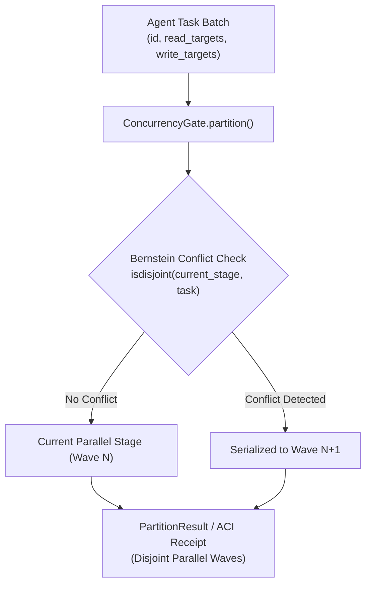

# concurrency-gate

[](https://github.com/skupriienko/concurrency-gate/actions)
[](https://kilo.org)
[](https://www.python.org/downloads/)
[](https://opensource.org/licenses/MIT)
[](https://github.com/astral-sh/ruff)
[](https://mypy-lang.org/)

> **Bernstein Multi-Agent Concurrency Safety & Parallel Task Partitioning Gate**  
> Verifies Bernstein's conditions across agent tasks to prevent parallel race conditions and serializes conflicting writes into disjoint execution waves.

---

## 🚀 Key Highlights

- **Bernstein Safety Verification:** Checks $R_1 \cap W_2 = \emptyset$, $W_1 \cap R_2 = \emptyset$, and $W_1 \cap W_2 = \emptyset$ before spawning subagents.
- **High-Performance Wave Partitioning:** Uses zero-allocation `isdisjoint()` sets to partition thousands of tasks into parallel stages in <1.0s (>2.5x speedup).
- **Conflict Resolution Receipt:** Generates typed ACI receipts (`[RECEIPT] status=OK sensor=concurrency_gate`) indicating verified parallel batches.
- **Native AI Tooling Integration:** Official first-class configuration for **Kilo Code**, **Claude Code**, **Cursor**, **Windsurf**, and **GitHub Copilot**.

---

## ⚡ Architecture & Workflow



---

## 📦 Installation

```bash
# Clone and install in editable mode
git clone https://github.com/skupriienko/concurrency-gate.git
cd concurrency-gate
bash install.sh
```

Or install via `pip`:
```bash
pip install -e .
```

---

## 🛠️ CLI Usage

```bash
# Verify parallel safety for individual tasks
concurrency-gate \
  --task "research_vue:docs/core.md" \
  --task "update_readme:docs/core.md" \
  --task "lint_code:src/main.py"

# Verify batch specification string
concurrency-gate --verify-batch "task_a:w=f1.txt;task_b:w=f2.txt;task_c:w=f1.txt"

# Emit JSON receipt for automated agent harnesses
concurrency-gate --verify-batch "t1:f1.txt;t2:f2.txt" --json
```

---

## 🐍 Python API

```python
from concurrency_gate import ConcurrencyGate, TaskSpec, PartitionResult

gate = ConcurrencyGate()

tasks = [
    TaskSpec(id="fetch_docs", writes=frozenset(["docs/spec.md"])),
    TaskSpec(id="audit_security", writes=frozenset(["reports/audit.json"])),
    TaskSpec(id="edit_spec", writes=frozenset(["docs/spec.md"])),  # Conflicts with fetch_docs
]

result: PartitionResult = gate.partition(tasks)
print(f"Stages count: {len(result.stages)}")
for stage in result.stages:
    print(f"Stage {stage.index}: {stage.task_ids}")
```

---

## 🤖 AI Tools Compatibility Matrix

| AI Environment | Integration Type | Path / Configuration |
| :--- | :--- | :--- |
| **Kilo / KiloCode** | Native Rules & Tools | `.kilo/kilo.jsonc` & `.kilo/rules/concurrency-gate.md` |
| **Cursor** | Project Rules | `.cursorrules` / `.kilo/rules/` |
| **Claude Code** | CLI & Sub-loops | Direct tool call via `concurrency-gate` |
| **Windsurf** | Agent Rules | `.windsurfrules` |
| **Aider / Copilot** | CLI Utilities | Standard shell execution |

---

## 🧪 Testing & Stress Benchmarks

```bash
# Run pytest stress test suite (2,000 tasks on 5 shared files partitioned in <1.0s)
pytest -v tests/test_stress.py
```

---

## 📄 License

MIT © [Serhii Kupriienko](https://github.com/skupriienko)
